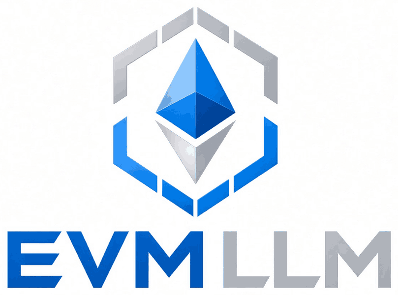
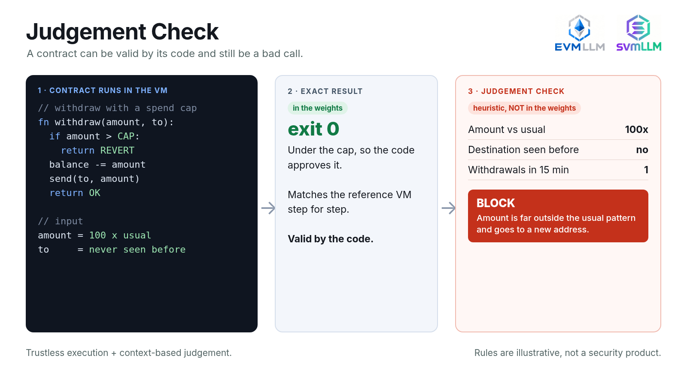

<p align="center"></p>

<h1 align="center">EVMLLM</h1>
<p align="center"><b>An Ethereum VM executed by transformer weights.</b><br>
Solidity contracts run on a RISC-V CPU that lives in compiled transformer layers: exact results, exact gas, zero training.</p>
<p align="center"><a href="https://evmllm.rexstjohn.com">Live demo: evmllm.rexstjohn.com</a> | <a href="https://github.com/Verafyai/evmLLM">github.com/Verafyai/evmLLM</a> | Sibling project: <a href="https://github.com/Verafyai/svmLLM">SVMLLM</a> (<a href="https://svmllm.rexstjohn.com">svmllm.rexstjohn.com</a>)</p>

---

## The pitch

EVMLLM runs Ethereum smart contracts on a CPU that lives inside transformer weights. A small EVM interpreter written in C is compiled to RISC-V (RV32IM) and executed by [Qwenputer](https://divagr.com/blog/qwenputer), a stack of transformer layers whose every weight was set by a compiler, not by training: attention heads fetch and decode instructions, SwiGLU feed-forward blocks do the arithmetic, and Gated DeltaNet heads act as exact RAM. The EVM is not hand-built into the weights: it is firmware, and the CPU that runs it is Qwenputer's. Ten Solidity contracts run on it, and every result is checked against py-evm.

On top of the VM sits a **judgement filter**: after the contract has run, a separate review step looks at the amount, the destination and the history, and returns allow, hold or block with a reason.

## Why: code that does exactly what it says

Some of the costliest smart-contract incidents involve code that ran exactly as written, with an outcome a sensible human operator would have stopped. Many others are ordinary bugs or key compromises; this project targets only the first kind. That gap motivated this project: fuse the best of smart contracts (trustless, deterministic and decentralized execution) with the best of human intelligence (judgement based on context).

A transformer that can execute contract bytecode exactly is a step toward a single model that both runs the program deterministically and reasons about whether the result makes sense.

<p align="center"></p>

---

## How it works

```
Solidity --solc--> EVM bytecode --+
                                  +--> job block in RAM
calldata, preset storage, gas ----+
C EVM interpreter (firmware/evm.c) --riscv gcc--> RV32IM ELF --> ROM

        Qwenputer chip layers (compiled, no training)
        +-----------------------------------------------------------+
token ->| attention: fetch pc, registers, ROM words, decode          |-> next token
   ^    | SwiGLU FFN: ALU (add, shift, multiply, compare, branch)    |      |
   |    | Gated DeltaNet: exact RAM (EVM stack, memory, storage)     |      |
   |    +-----------------------------------------------------------+      |
   +------------------------ fed back as the next input -------------------+
```

1. **Bytecode.** Each demo is compiled with solc 0.8.24 (optimizer on, Shanghai). The runtime bytecode, calldata, preset storage slots and gas limit are packed into a job block that the firmware reads from RAM.
2. **Fetch and decode via attention.** Qwenputer emits one structured token per micro-step (families such as `F0/F1/F2` fetch, `V` value, `J` jump, `ST/SS` store, `QD/QS` query). Attention heads look up the program counter, register values and ROM words from earlier tokens.
3. **ALU in the FFN.** SwiGLU blocks implement RV32IM plus Zba arithmetic exactly. The EVM's 256-bit words are 8 x 32-bit limbs: ADD/SUB are carry chains, MUL is schoolbook, DIV/MOD use a single-limb fast path and Knuth algorithm D for multi-limb divisors, EXP is square and multiply.
4. **Stack, memory and storage as exact RAM.** Gated DeltaNet heads with one-hot keys store bytes exactly. The EVM stack (96 entries), memory (2 KB) and storage (48 slots) all live there.
5. **Result.** The firmware prints each executed EVM opcode as two hex characters, then the status, gas, return data and changed storage, all as `BYTE` tokens. Every token the model predicts is fed back as its next input.

One EVM opcode costs roughly 80 to 170 RV32 instructions (about 90 to 190 tokens), after a start-up of 1,500 to 4,500 tokens (job load and the JUMPDEST scan).

### What is in the weights and what is emulated

| Part | Where it runs |
|---|---|
| RV32IM + Zba CPU (fetch, decode, ALU, registers, RAM) | **In the weights** (Qwenputer chip layers, compiled by chipformer) |
| EVM interpreter | Software: C firmware executed **by** that CPU, instruction by instruction |
| Bit-exact reference of the circuit (`chipformer.rv.ref`) | Python, used to produce the expected token trace |
| Circuit runs in this repo | Qwenputer's `fastexec.FreeRun` on CPU: the compiled weights in fp32 with sparse matrices, autoregressive |
| Full Qwen3.5-4B merge (18.8 GB) | **Not run yet**: needs a 24 GB GPU |
| Judgement filter | Ordinary Python/JavaScript after the VM. **Not part of the weights** |
| Browser VM on the site | JavaScript port of the firmware's EVM, checked against py-evm |

## What it can do

- Execute real solc output: function dispatch, checked arithmetic (Panic 0x11), `require`/`revert` with `Error(string)`, SLOAD/SSTORE, MLOAD/MSTORE, loops and jumps.
- Exact gas: execution gas (without the 21,000 intrinsic) matches py-evm, including warm/cold storage access (EIP-2929), SSTORE pricing (EIP-2200/3529 without refunds) and memory expansion.
- Opcodes: STOP, ADD, MUL, SUB, DIV, MOD, EXP, LT, GT, SLT, SGT, EQ, ISZERO, AND, OR, XOR, NOT, BYTE, SHL, SHR, SAR, ADDRESS, CALLER, CALLVALUE, CALLDATALOAD, CALLDATASIZE, CALLDATACOPY, CODESIZE, CODECOPY, RETURNDATASIZE, POP, MLOAD, MSTORE, MSTORE8, SLOAD, SSTORE, JUMP, JUMPI, PC, MSIZE, GAS, JUMPDEST, PUSH0 to PUSH32, DUP1 to DUP16, SWAP1 to SWAP16, RETURN, REVERT, INVALID.

## Demo contracts

All sources are in [`contracts/Demos.sol`](contracts/Demos.sol). The numbers come from `tests/demos_ref.py` (firmware on the reference machine, checked against py-evm).

| # | Contract | Input | Result | Gas | EVM ops | Tokens |
|---|---|---|---|---|---|---|
| 1 | SpendCap | $250,000 | `returns 250000000000` | 22,581 | 115 | 16,687 |
| 1 | SpendCap | $999,999,999 | `returns 999999999000000` | 22,581 | 115 | 16,750 |
| 1 | SpendCap | $1,000,000,001 (over cap) | `revert: exceeds $1B cap` | 326 | 92 | 16,807 |
| 2 | Counter | add 1 to 41 | `returns 42` | 5,477 | 113 | 16,370 |
| 2 | Counter | add 1000 to 41 | `returns 1041` | 5,477 | 113 | 16,373 |
| 3 | Fibonacci | fib(10) | `returns 55` | 1,637 | 477 | 45,351 |
| 3 | Fibonacci | fib(90) | `returns 2880067194370816120` | 12,357 | 3,597 | 313,542 |
| 4 | Factorial | 10! | `returns 3628800` | 2,109 | 603 | 57,933 |
| 4 | Factorial | 57! | `returns ...000000` | 11,650 | 3,329 | 348,393 |
| 4 | Factorial | 58! (overflow) | `revert: Panic(0x11)` | 11,699 | 3,342 | 349,759 |
| 5 | GCD | gcd(1071, 462) | `returns 21` | 619 | 175 | 19,520 |
| 5 | GCD | gcd(2^128, 6^40) | `returns 1099511627776` | 3,269 | 900 | 102,174 |
| 6 | Prime | 97 | `returns True` | 2,590 | 725 | 69,981 |
| 6 | Prime | 91 | `returns False` | 1,846 | 516 | 51,345 |
| 6 | Prime | 7919 | `returns True` | 24,157 | 6,729 | 605,944 |
| 7 | Token | account 0 sends 30 to 1 | `returns 70000000000000000000` | 10,924 | 221 | 30,458 |
| 7 | Token | account 1 sends 6 to 0 (short) | `revert: insufficient balance` | 2,587 | 140 | 23,711 |
| 8 | Vault | withdraw 200 | `returns 1800000000000000000000` | 7,706 | 124 | 18,852 |
| 8 | Vault | withdraw 600 (over limit) | `revert: over withdrawal limit` | 2,427 | 94 | 18,244 |
| 9 | Voting | voter 0 votes for candidate 0 | `returns 4` | 10,958 | 224 | 31,929 |
| 9 | Voting | voter 2 votes again (rejected) | `revert: already voted` | 2,666 | 145 | 25,680 |
| 10 | Escrow | code 424242 | `returns 25000000000000000000` | 26,730 | 101 | 16,461 |
| 10 | Escrow | code 111111 (condition not met) | `revert: condition not met` | 4,564 | 104 | 18,701 |

## Judgement filter


The flow is `transaction -> exact EVM run -> rule-based review -> optional LLM judge -> allow / hold / block`.

- The VM result is never changed. If the code reverts, the review just reports it.
- The review (`evmllm/judge.py`, ported to `judge.js` on the site) is ordinary code and **not part of the weights**. It scores the amount against the account's history (median size), whether the destination was seen before, bursts of withdrawals within 10 minutes, the share of the contract cap and of the balance moved.
- `LLMJudge` is a pluggable interface: pass any `complete(prompt) -> str` function. The default stub abstains. An LLM can only make a decision stricter, never looser.

Five scenarios with synthetic histories (`PYTHONPATH=. python -m evmllm.judge_examples`). Every VM run matches py-evm:

| Scenario | Call | VM | Verdict | Reasons |
|---|---|---|---|---|
| Valid withdrawal, 100x usual size, never-seen address | `withdraw(450 ETH)` | returns 1550000000000000000000 | **BLOCK** (65) | 111x the usual size (median 4.05 ETH); destination 0x7e5700000000000000000000000000000000bad0 never seen before |
| Ordinary transfer to a known address | `transfer(3 tokens)` | returns 97000000000000000000 | **ALLOW** (0) | in line with history, known destination |
| Rapid repeated withdrawals, each one within the limit | `withdraw(490 ETH)` | returns 40000000000000000000 | **BLOCK** (65) | 4 withdrawals in 10 minutes (1,960 ETH total); pattern would drain over half the balance; empties 90%+ of the balance |
| Spend under the $1B cap, but 95% of it in one call | `spend($950,000,000)` | returns 950000000000000 | **HOLD** (50) | 24x the usual size (median 39.0M USD); 95% of the contract cap in one call |
| Spend over the $1B cap: the code itself reverts | `spend($1,200,000,000)` | revert: exceeds $1B cap | **BLOCK** (100) | VM: revert: exceeds $1B cap; the code itself rejected it, nothing to review |

## Quickstart

```bash
git clone https://github.com/Verafyai/evmLLM && cd evmLLM

# Qwenputer (MIT) at the tested commit, plus a two-line patch so fastexec loads the standalone chip
git clone https://github.com/divagr18/qwenputer /tmp/qwp
git -C /tmp/qwp checkout f07a0b2
git -C /tmp/qwp apply "$PWD/qwenputer-cpu.patch"

sudo apt install gcc-riscv64-unknown-elf          # only needed to rebuild the firmware
python3 -m venv .venv && . .venv/bin/activate
python3 -m pip install -r requirements.txt -e /tmp/qwp/experimental/riscv

./firmware/build.sh                               # C EVM -> firmware/evm.elf (a prebuilt ELF is included)
PYTHONPATH=. python tests/demos_ref.py            # 23 demo runs vs py-evm
PYTHONPATH=. python tests/fuzz.py 2000            # 2000 random programs vs py-evm
PYTHONPATH=. python tests/divtest.py              # 256-bit DIV/MOD vs Python ints
PYTHONPATH=. python examples/run_on_weights.py    # a small program on the compiled weights (about 2 min on CPU)
PYTHONPATH=. python examples/run_on_weights.py --row 10   # gcd(1071, 462) on the weights
THREADS=4 PYTHONPATH=. python -u tests/circuit_run.py 0 3 10   # batched demo rows on the weights
PYTHONPATH=. python -m evmllm.judge_examples      # judgement filter scenarios
PYTHONPATH=. python -m evmllm.export_site ../evllm-site   # regenerate the site's data.js
```

Running on the weights, in short:

```python
from chipformer.rv import core, fastexec, spec as S
from evmllm.host import Job, machine, run_ref

job = Job(code=bytes.fromhex("6007600501805f555f5260205ff3"), trace=True)  # 5 + 7, store, return
ref = run_ref(job)                         # bit-exact reference trace
c = core.build()                           # RV32IM CPU compiled into weights
fr = fastexec.FreeRun(c, 1, "cpu", False, sparse=True)
core.snapshot(c, machine(job))             # firmware ROM + job into the RAM state
fr.load(0, S.tok("GO"))
out = fr.run(len(ref._toks) - 1)[0]        # autoregressive: each output is the next input
assert (out == ref._toks[1:]).all()
```

## Test results

| Test | Pass | What is compared |
|---|---|---|
| Demo runs (10 contracts, 23 inputs), firmware vs py-evm | **23/23** | status, return data, gas, changed storage |
| Random programs, firmware vs py-evm (Shanghai) | **2000/2000** | status, return data, gas, changed storage |
| 256-bit DIV/MOD, firmware vs Python ints | **400/400** | quotient and remainder, multi-limb divisors |
| Browser VM (`evm.js`) vs py-evm corpus | **2023/2023** | the 23 demos plus the 2000 fuzz cases |
| Judgement filter, JS port vs Python | **5/5** | VM result, verdict, score, reasons |
| Runs on the compiled weights (fastexec, CPU) | **12/12 runs, 338,555 tokens** | every generated token vs the reference trace |

Runs on the compiled weights (each generated token fed back as the next input):

| Contract | Input | Tokens | Result |
|---|---|---|---|
| SpendCap | $250,000 | 16,686 | exact match |
| SpendCap | $1,000,000,001 (over cap) | 16,806 | exact match |
| Counter | add 1 to 41 | 16,369 | exact match |
| Fibonacci | fib(10) | 45,350 | exact match |
| Factorial | 10! | 57,932 | exact match |
| GCD | gcd(1071, 462) | 19,519 | exact match |
| Prime | 91 | 51,344 | exact match |
| Token | account 0 sends 30 to 1 | 30,457 | exact match |
| Token | account 1 sends 6 to 0 (short) | 23,710 | exact match |
| Vault | withdraw 600 (over limit) | 18,243 | exact match |
| Voting | voter 2 votes again (rejected) | 25,679 | exact match |
| Escrow | code 424242 | 16,460 | exact match |

## Repository layout

```
firmware/        evm.c (the EVM, 256-bit words as 8 x 32-bit limbs), crt0, linker script, build.sh, evm.elf
evmllm/host.py   job packing, reference-machine runner, py-evm runner, result parsing
evmllm/demos.py  the 10 contracts and 23 demo inputs
evmllm/judge.py  judgement filter (rules + pluggable LLM judge stub); judge_examples.py has 5 scenarios
evmllm/export_site.py   writes the site's data.js from real runs
contracts/       Demos.sol and compiled artifacts (solc 0.8.24)
tests/           demos_ref.py, fuzz.py, divtest.py, circuit_run.py, export_corpus.py, check_js_vm.js
examples/        run_on_weights.py
results/         JSON outputs of the runs above
assets/          logo, mark, favicon, social card
qwenputer-cpu.patch   two-line fastexec fix for the standalone chip
```

## Where this could run

This is a demo that exact computation can live in a model's weights. It is not a node replacement.

**Realistic today**

- **Sidecar next to the chain software.** A node operator runs the model beside their own client and uses it to review, flag or hold transactions in their own RPC endpoint, mempool view or wallet guard. It affects only that operator's infrastructure, not consensus. This is the realistic path today.
- **Off-chain checker and audit.** Re-run a transaction on the weights machine, compare it to the reference result, and attach the review to an audit trail.
- **Judgement layer in front of a wallet or multisig.** The exact VM result plus the review step decides allow, hold or block before a signer approves.

**Research direction: part of consensus**

Making the weights machine part of consensus would need:

- **Determinism.** GPU floating point can differ across hardware and software versions. The weights here use exact lookup-table style math with values that stay exactly 0 or 1, but a full Qwen-sized model is a much bigger problem.
- **Cost and speed.** A tiny program takes tens of thousands of tokens, and every validator would have to repeat it. Each EVM opcode costs 90 to 190 tokens here, after a start-up of 1,500 to 4,500 tokens.
- **Compute limits.** The model run would need to be metered and bounded by gas like any other execution.

The judgement filter is illustrative heuristics on synthetic histories, not a security product.

## Honest limitations

- The weights runs use Qwenputer's compiled chip layers on CPU (fp32, sparse). The full 18.8 GB merged checkpoint has not been run yet.
- Opcode subset only: no KECCAK256 (so no mappings), no CALL/CREATE/LOG, no SDIV/SMOD/SIGNEXTEND/ADDMOD/MULMOD, no precompiles.
- Build limits: 3,072 bytes of code, 256 bytes of calldata, 2 KB memory, 96-entry stack, 48 storage slots. Going over halts with status "build limit".
- Single call with preset storage. No state trie, no persistence between runs, gas refunds not tracked.
- Slow: tens to a few hundred tokens per second on CPU, and a demo run is 15,000 to 600,000 tokens.
- The judgement filter is simple heuristics on synthetic histories. It is a design sketch, not a security product.

## Future possibilities

- **Faster execution.** Qwenputer's GPU executor and a leaner trace format (skip the per-opcode hex print) should give orders of magnitude more tokens per second.
- **A chat bridge.** A small bridge firmware so the model can call `evm_run(bytecode, calldata)` mid-conversation and read back exact results, with the judgement filter as an in-context reviewer.
- **More of the EVM.** KECCAK256 (unlocks Solidity mappings), LOG, SDIV/SMOD/SIGNEXTEND/ADDMOD/MULMOD, larger memory and storage, and multi-call state.
- **Smarter review.** A real LLM judge behind the `LLMJudge` interface, richer history features, and per-protocol policies.

## Next steps: run inside the full Qwenputer checkpoint (needs a GPU)

Every weights run so far uses Qwenputer's compiled chip layers on CPU. The next step is the merged model, where the same CPU sits inside Qwen3.5-4B.

1. Get a single 24 GB GPU (the Qwenputer post uses an L4). The merged checkpoint is 18.8 GB, and the post reports about 3,200 CPU tokens per second for its batched executor on an L4.
2. Reproduce Qwenputer first, using the commands from the post:
   ```bash
   git clone https://github.com/divagr18/qwenputer && cd qwenputer/experimental/riscv && uv sync --extra hf
   hf download divagr1925/Qwen3.5-4B-Qwenputer --local-dir qwenputer-rv
   uv run python -m chipformer.rv.chat qwenputer-rv --firmware tests/data/rv/calc-bridge.elf \
       --ask "Use calc: what is 123456789 * 987654321?"
   ```
3. Load `firmware/evm.elf` with a job block in place of the calculator firmware, run the 12 weights rows and the 23 demo inputs, and require every token to match the reference trace, as the CPU runs here do.
4. Add a small bridge firmware so the model can call `evm_run(bytecode, calldata)` mid-conversation, then wire the judgement filter to Qwen itself through `LLMJudge`, so one model runs the contract exactly and reviews the result.

## Support

Drop me some ETH if you want to support me to keep working on this.

```
0xF2c09bB10Fd950095DD14Ff3289B82f9E264d826
```

## Credits

- **Qwenputer** by Divyansh Agrawal ([@divagr1925](https://x.com/divagr1925/status/2115394340357116169)): [blog post](https://divagr.com/blog/qwenputer), [weights on Hugging Face](https://huggingface.co/divagr1925/Qwen3.5-4B-Qwenputer), [code](https://github.com/divagr18/qwenputer) (MIT). EVMLLM would not exist without it: the CPU in the weights, the chipformer compiler, the reference machine and the fastexec executor are all Qwenputer's.
- **py-evm** (Ethereum Foundation) as the reference EVM, **solc** for compilation.
- Sibling project: [SVMLLM](https://github.com/Verafyai/svmLLM), a Solana sBPF VM in hand-built weights ([svmllm.rexstjohn.com](https://svmllm.rexstjohn.com)).

## License

MIT, see [LICENSE](LICENSE). Qwenputer is MIT, Copyright (c) 2026 Divyansh Agrawal.
